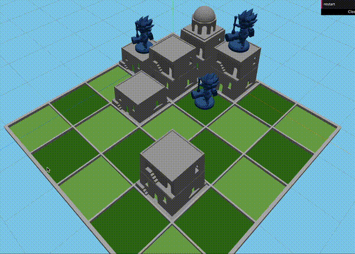

# Santorini Online

## About the Project

**Santorini Online** is a web-based version of the popular board game **Santorini**. This project brings the gameplay experience online, allowing users to compete against friends or AI, with full rule enforcement and game persistency. It’s designed to capture the strategy of the original board game while ensuring a seamless experience in the digital world.




## Technologies Used

Here are the key technologies and libraries used in this project:

<p align="center">
  <a href="https://nodejs.org/" target="_blank" rel="noopener noreferrer">
    
  </a>
  <a href="https://expressjs.com/" target="_blank" rel="noopener noreferrer">
    
  </a>
  <a href="https://kysely.dev/" target="_blank" rel="noopener noreferrer">
    
  </a>
  <a href="http://www.passportjs.org/" target="_blank" rel="noopener noreferrer">
    
  </a>
  <a href="https://threejs.org/" target="_blank" rel="noopener noreferrer">
    
  </a>
  <a href="https://www.typescriptlang.org/" target="_blank" rel="noopener noreferrer">
    
  </a>
</p>

## Contributing

This is a personal portfolio project, and I'm the primary contributor. However, if you'd like to contribute, feel free to:

1. **Open an Issue**: If you find a bug or have a suggestion, please open an issue to discuss it.
2. **Submit a Pull Request**: Fork the repository, make your changes in a new branch, and submit a pull request for review.

### Steps for Pull Requests

1. Fork the repository.
2. Create a new branch for your feature:
3. Commit your changes:

   ```bash
   git commit -m 'feat: add YourFeatureName'
   ```

4. Push to your branch:

   ```bash
   git push origin feature/YourFeatureName
   ```

5. Open a pull request and explain your changes.

## 📖 How to Play

In **Santorini**, the goal is to be the first player to move one of your workers onto the third level of a building. Players take turns moving one worker and building a block or dome.

### Basic Rules

1. **Move**: Move one of your workers to an adjacent space.
2. **Build**: After moving, build a block or dome in an adjacent space.
3. **Win**: If you can move one of your workers to the third level of a building, you win!

For a more detailed explanation of the rules, check out the [official Santorini rules](https://roxley.com/santorini).

## 📝 License

This project is licensed under the **AGPL-3.0 License**. See the [LICENSE](./LICENSE) file for more details.

## 📦 Running it locally

You need [Docker](https://www.docker.com/) (for PostgreSQL) and either [Node.js](https://nodejs.org/) 26 or [Nix](https://nixos.org/). The scripts start the Nix shell from `packages/server` by themselves when `npm` is not on your `PATH`. With [direnv](https://direnv.net/), run `direnv allow` in the repo root or in a package: it loads Node 26 from the Nix flake and prints the commands for that folder, or tells you what to install if Nix with flakes is not available.

```bash
git clone https://github.com/neves-nvs/santorini.git
cd santorini
scripts/install   # npm ci in every package
scripts/dev       # starts PostgreSQL in Docker, runs migrations, then the server and client
```

- Server: <http://localhost:3000>
- Client: <http://localhost:5174>

`scripts/dev` uses local development defaults (see the scripts for the variables). Running `npm run dev` yourself in `packages/server` and `packages/client-react` works without any setup too: the server listens on port 3000 and the client talks to `localhost:3000` in development. The database container keeps running after you stop it; stop it with `scripts/db-down`.

## Acknowledgements

- Thanks to the creators of the original **Santorini** board game.
- The 3D models for the game pieces are not mine; see [CREDITS.md](./CREDITS.md) for their sources.
