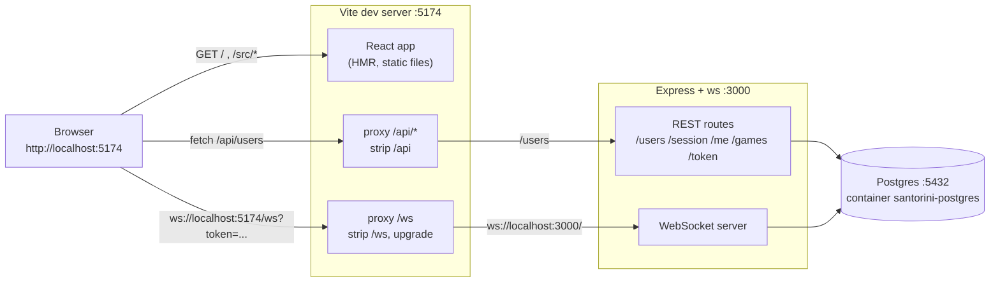
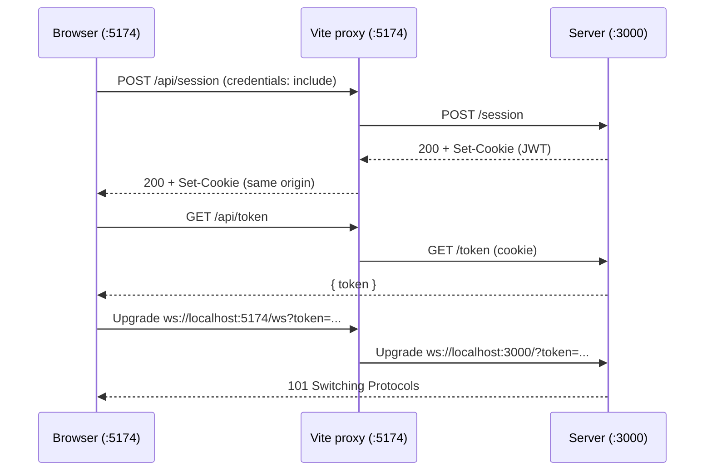

# Dev networking

`scripts/dev` starts Postgres, the server and the Vite dev server. The browser only ever talks to Vite (`:5174`); Vite forwards API and WebSocket traffic to the server (`:3000`), so every request is same-origin and needs no CORS.

## Request path

## Where it is configured

| Piece | File |
| --- | --- |
| Proxy rules (`/api`, `/ws`) | `packages/client-react/vite.config.ts` |
| Client base URL (`VITE_API_URL`) and WebSocket URL (`VITE_WS_URL`) | `packages/client-react/src/services/` |
| Server port (default 3000) | `packages/server/src/configs/config.ts` |
| Database container | `scripts/db-up` |

Docker uses the same shape: the nginx frontend container serves the build and proxies `/api` and `/ws` to the server container.
